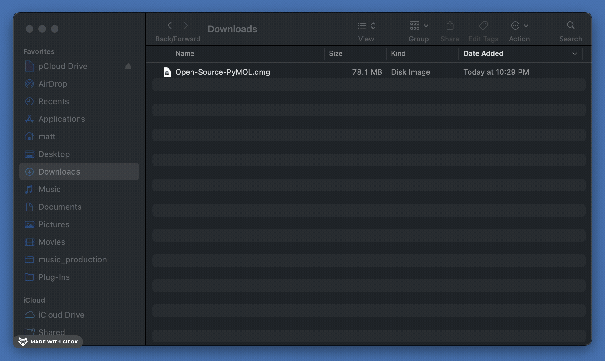
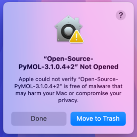

# Installation for macOS

## Step-by-Step Installation Guide
For a convenient and user-friendly installation follow these steps 
(installation should take around **1 minute**):

### Step 1 - Download .dmg
Open-Source PyMOL requires macOS 12 (Monterey) or newer. Download the DMG for your Mac:

- Apple Silicon (M1, M2, M3, ...): {{ download_link("_macOS_AppleSilicon.dmg") }}
- Intel: {{ download_link("_macOS_Intel.dmg") }}

Not sure which Mac you have? Open the Apple menu and choose _About This Mac_:
"Chip: Apple M..." means Apple Silicon, "Processor: ... Intel ..." means Intel.
The download will take around a minute depending on your internet connection.

### Step 2 - Navigate to the Downloads folder
After the download finished open a Finder window and navigate to _Downloads_.

### Step 3 - Install
Double-click on the file **.dmg** and then drag the Open-Source PyMOL icon on the _Applications_ folder:

### Step 4 - Certificate bypass
After the installation of PyMOL, it could be that you see this warning:

However, you can still open it, but for this you must go to your System Settings and open that explicitly:

