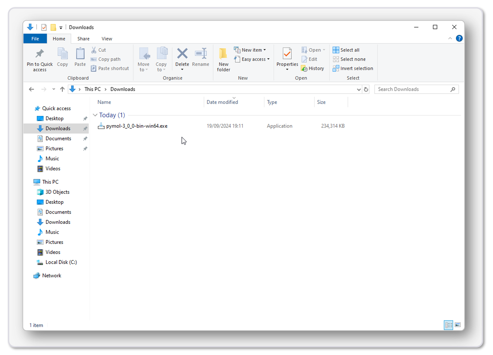
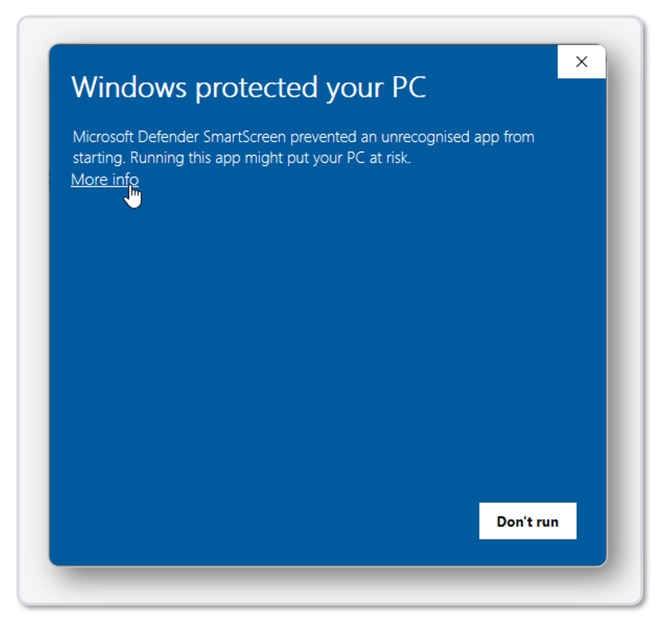
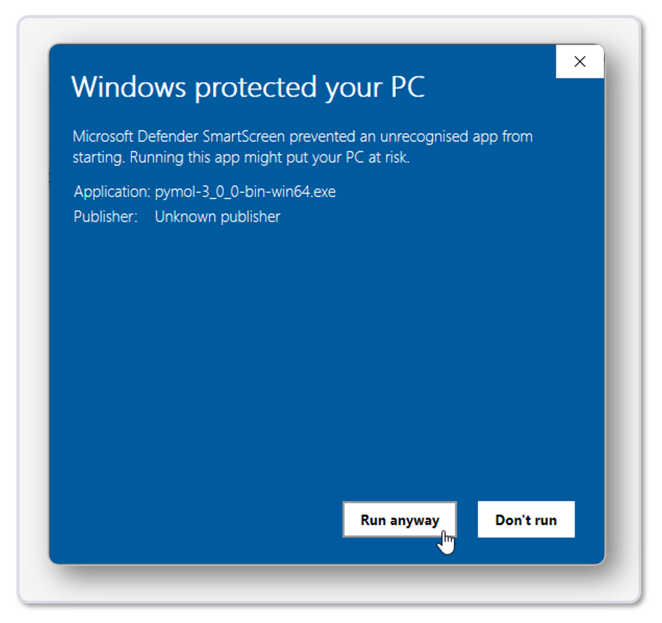
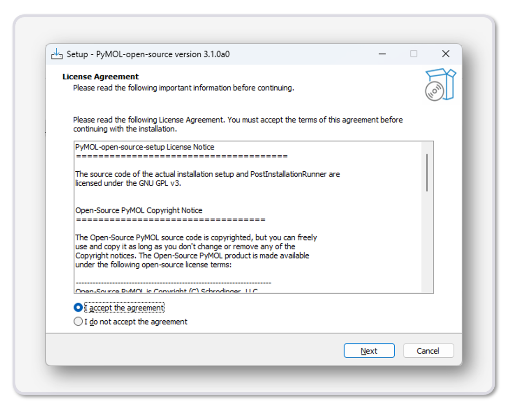
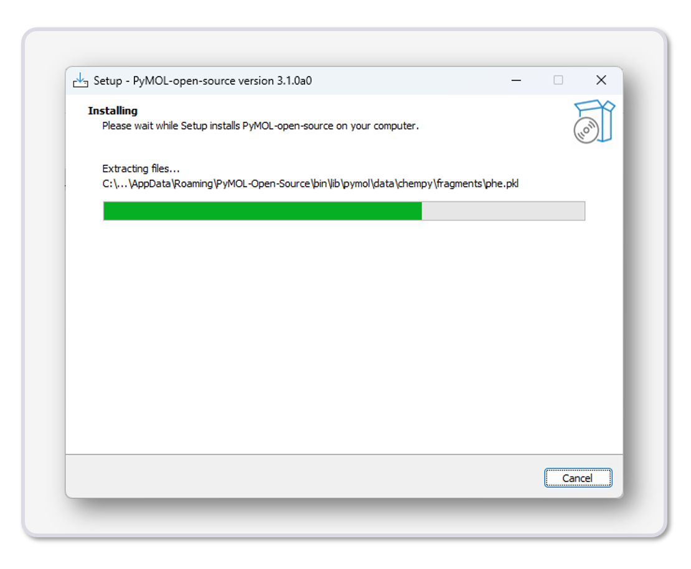
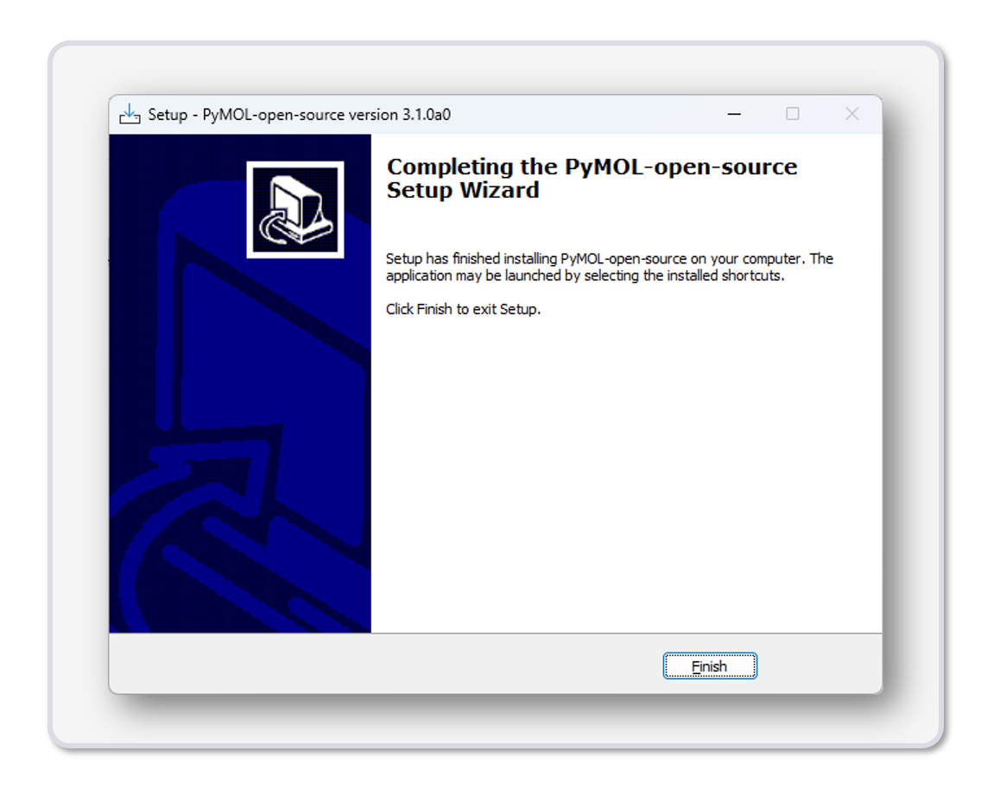
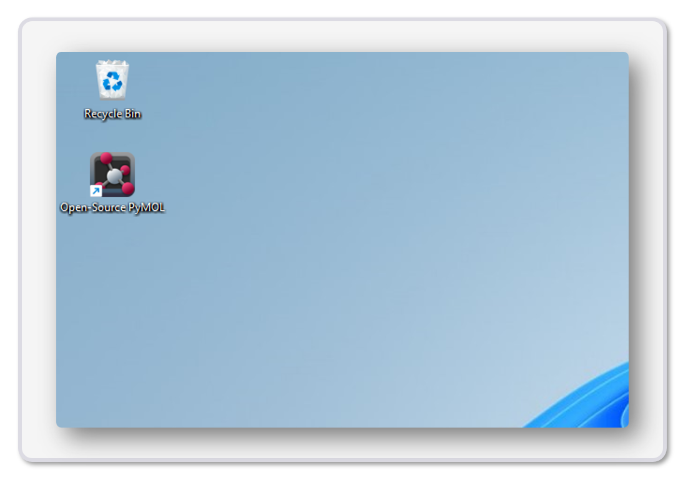
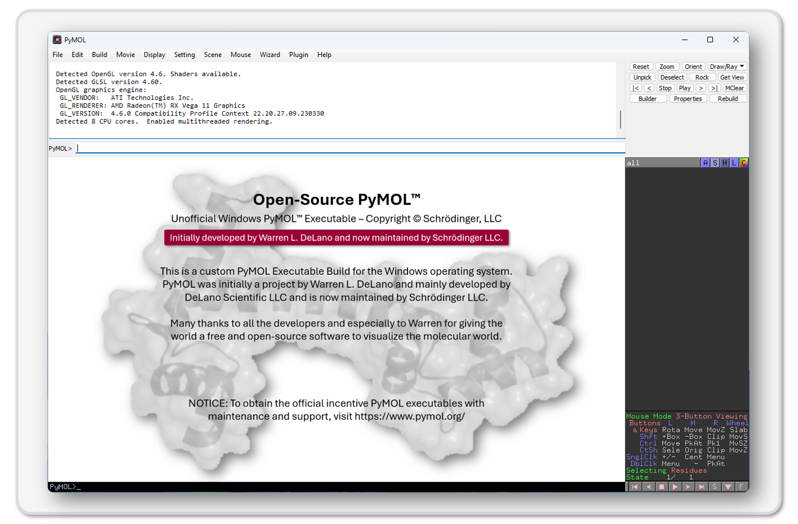

# Installation for Windows Operating System
Install location: `C:\Users\%USERNAME%\AppData\Roaming\PyMOL-Open-Source\bin`

## Step-by-Step Installation Guide
For a convenient and user-friendly installation follow these steps (installation should take around **5 minutes**):

1. Download the {{ download_link("_x64_setup.exe") }} (Windows 10 version 22H2 or Windows 11, 64-bit). The download will take around a minute depending on your internet connection.

2. After the download finished open a Windows explorer window and navigate to _Downloads_.

3. Double-click on the file **{{ file_name("_x64_setup.exe") }}** to start the setup.
    <div id='header' align='center'>
      
    </div>

4. Depending on the security settings a Windows protected your PC dialog will open. Click on **More info** to proceed.
    <div id='header' align='center'>
      
    </div>

5. Click on **Run anyway** to start the setup.
    <div id='header' align='center'>
      
    </div>

6. Agree to the license agreement and click on **Next**.
    <div id='header' align='center'>
      
    </div>

7. Wait for the installation to finish (This step takes around **1 minute** to complete).
    <div id='header' align='center'>
      
    </div>

8. Click on **Finish**.
    <div id='header' align='center'>
      
    </div>

9. Start PyMOL by double-clicking on the desktop icon.
    <div id='header' align='center'>
      
    </div>
    
    <div id='header' align='center'>
      
    </div>

## Troubleshooting
If PyMOL closes right after the start or shows no molecules, the graphics driver may not
support OpenGL 2 (e.g. in a virtual machine). Then start PyMOL with Qt's software rendering:
open a command prompt in the installation folder `bin` and run
```shell
set QT_OPENGL=software
Open-Source-PyMOL.exe
```
